## PC components
| Description | Preview |
|:-------------------------:|:-------------------------:|
|**be quiet! SILENT BASE 802 Window Black**  [Official page](https://www.bequiet.com/en/case/2047) | 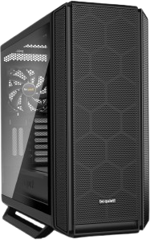 |
|**Z790 AORUS ELITE AX (Rev. 1.x)**  [Official page](https://www.gigabyte.com/Motherboard/Z790-AORUS-ELITE-AX-rev-1x) | 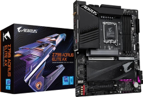 |
|**Intel(R) Core(TM) i7-14700KF** [Official page](https://www.intel.com/content/www/us/en/products/sku/236789/intel-core-i7-processor-14700kf-33m-cache-up-to-5-60-ghz/specifications.html) |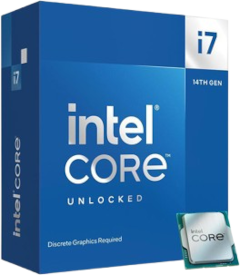 |
|**be quiet! Pure Loop 360mm**  [Official page](https://www.bequiet.com/en/watercooler/1959)|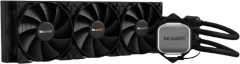|
|**EXPERT DDR5 DESKTOP MEMORY BLACK 64GB(2x32GB) 6400MHz CL34**  [Official page](https://www.teamgroupinc.com/en/product-detail/memory/T-CREATE/expert-u-dimm-ddr5-black/expert-u-dimm-ddr5-black-CTCED564G6400HC34BDC01/) | 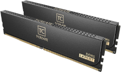 |
|**Chieftec Proton BDF-1000C**  [Official page](https://www.chieftec.eu/products-detail/160/PROTON_SERIES/223/BDF-1000C) | 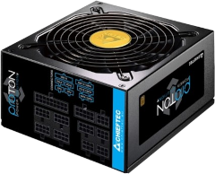 |
|**NVIDIA GeForce GTX 1080 Ti**  [Official page](https://www.gigabyte.com/Graphics-Card/GV-N108TGAMING-11GD#tab-kf) |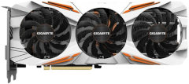|
|**Samsung SSD 870 EVO 2TB**  [Official page](https://www.samsung.com/au/memory-storage/sata-ssd/870-evo-2tb-sata-3-2-5-ssd-mz-77e2t0bw/)|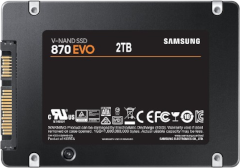|
|**Samsung SSD 870 EVO 1TB**  [Official page](https://www.samsung.com/au/memory-storage/sata-ssd/870-evo-1tb-sata-3-2-5-ssd-mz-77e1t0bw/)|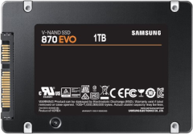|
|**Samsung SSD 970 EVO Plus 500GB**  [Official page](https://www.samsung.com/au/memory-storage/nvme-ssd/970-evo-plus-nvme-m-2-ssd-500gb-mz-v7s500bw/)|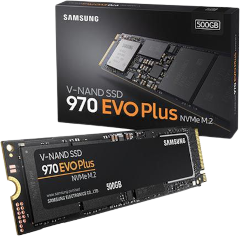|
|**Toshiba P300 HDWD120 2TB 3.5**  [Official page](https://www.toshiba-storage.com/nl/products/toshiba-internal-hard-drives-p300/)|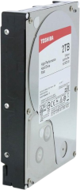 |
|**Genesis Thor 300**  [Official page](https://genesis-zone.com/product/thor-300-rgb-red)| 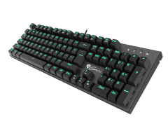 |
|**Laser Gaming Mouse (XL-747H)**  [Official page](http://x7.a4tech.com/product.aspx?id=74)|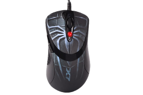 |
|**HyperX Cloud Alpha S**  [Official page](https://row.hyperx.com/ru/products/hyperx-cloud-alpha-s?variant=40910061142221)|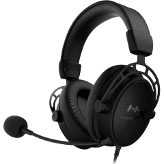 |
|**ASUS SBW-06D5H-U**  [Official page](https://www.asus.com/be-nl/motherboards-components/optical-drives/external-blu-ray-drive/sbw-06d5h-u/) | 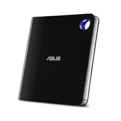 |
|**Printer Pantum M6550NW**  [Official page](https://global.pantum.com/product-center/1517382966511185922.html)                | 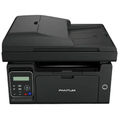 |
|||
